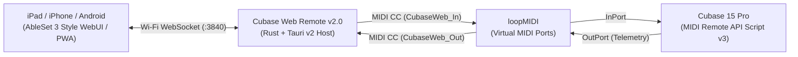

# Cubase Web Remote (v2.0 — AbleSet 3 Style Update)

Windows 上の **Steinberg Cubase 15 Pro**（Cubase 12 以降の MIDI Remote API 対応グレード）を、同一 Wi-Fi 内の **iPad / iPhone / Android ブラウザ（WebUI・PWA）** から超低遅延・リアルタイム双方向同期で操作するためのステージ＆スタジオ向けリモートコントローラーです。

v2.0 では、ライブ同期・マニピュレーター業界の世界標準ツール **「AbleSet 3」** の UI/UX デザインと高機能セットリスト管理・進捗トラッキングを全面的に取り入れ、**iPad（横向き 2ペイン Split Console / 縦向き Zero-Scroll）** に極限まで最適化されたステージ仕様へと大幅に進化しました。

---

## 主な特徴 (v2.0)

### 1. AbleSet 3 スタイルのステージ視認性 (Stage-Ready UI)
- **ディープチャコール & 高コントラスト・ネオンカラー**:
  - 暗いステージや直射日光下でも一瞬で判別できる大文字タイポグラフィ。
  - サビ（ローズ）、A/Bメロ（シアン）、Intro/Outro（アンバー/エメラルド）などセクションごとの明快なカラーコーディング。
- **拍パルス・インジケーター (Beat Lamps)**:
  - Bars+Beats（小節・拍）のカウントとともに、`1 2 3 4` の拍ライトが曲のテンポに合わせてリアルタイムに点滅。

### 2. 4つの専用マルチビュー（上部タブで即座に切替）
- **① PERFORMANCE（メイン演奏・同期出し画面）**
  - **CURRENT SONG バナー**: 巨大な曲名、Key、BPM、曲全体のリアルタイム進捗バー（経過/残り時間カウントダウン）。
  - **NEXT UP バナー**: 次曲のスタンバイ表示とワンタップ頭出しキュー。
  - **インタラクティブ・セクションタイル**: 演奏中のセクションが脈動発光（Active Section Glow）し、内部に進捗ラインを表示。タイルをタップするとその小節へダイレクトジャンプ。
  - **安全ロック (Stage Safety Lock)**: 演奏中に誤って画面に触れても曲が飛ばない安全スイッチ。
  - **クイックループ (`+LOOP`)**: 練習やライブMC中、現在セクションをワンタップで無限反復。
  - **1タップ・リテイク**: 宅録・リハで失敗したテイクを「停止→直前テイク削除→開始位置復帰→再録音」まで自動マクロ実行。
- **② SETLIST（高機能セットリストエディタ）**
  - **曲順並び替え**: 上下ボタンでライブの曲順を自在に入替。
  - **アコーディオン式セクション編集**: 各曲を展開し、セクション（Intro, Verse, Chorus...）の開始小節を編集。Cubase の現在カーソル位置をワンタップでキャプチャ可能。
  - **曲間オートストップ (`+STOP`)**: 曲終わりに達したら自動的に Cubase を停止し、次曲の頭で待機するライブ同期の鉄則機能。
  - **クリップボード入出力**: メモ帳から `1. 曲名 / 2. 曲名` のテキストを一発ペーストで一括インポート可能。
- **③ MIXER（ステージ用リモートミキサー）**
  - **Cubase 選択トラック直結**: 音量フェーダー、dB表示、Mute、Solo、Rec待機、Monitor、トラック前後切替。
  - **6チャンネル・ステージステム**: Click、Guide、Drums、Bass、Music、Vocals の音量バランスとMute/Soloを手元で即調整。
- **④ LYRICS（歌詞・コード進行リアルタイム同期）**
  - 演奏中のセクション（`[Intro]`, `[Verse 1]`, `[Chorus]`）に合わせて、該当ブロックをリアルタイムで自動ハイライト。
  - ステージ用フォントサイズ切替（標準 / 大 / 特大）＆インライン編集対応。

### 3. iPad 向け専用最適化 (iPad Ergonomics)
- **横向き（Landscape: 2ペイン Split Console）**:
  - 左ペイン（約35%）にセットリスト一覧、右ペイン（約65%）に現在曲の特大セクションブロックと進捗バーを常時並列表示。画面遷移なしで全体と現在位置を同時把握。
- **縦向き（Portrait: Zero-Scroll Stage Mode）**:
  - 演奏中に指をスクロールさせる必要がないよう、主要情報がファーストビュー内に収まる設計。
- **ステージ操作の安全性**:
  - 特大タップターゲット（最小 56〜72px）、誤ダブルタップズームやバウンススクロールの完全防止、iPad ホームバー（セーフエリア）対応、Screen Wake Lock による画面常時点灯。

---

## システム構成



---

## 動作環境

- **ホスト PC**: Windows 10 / Windows 11 (64-bit)
- **対象 DAW**: Steinberg Cubase 15 Pro（MIDI Remote API 対応の Cubase 12 以降に対応）
- **仮想 MIDI ドライバ**: [loopMIDI](https://www.tobias-erichsen.de/software/loopmidi.html)（無料）
- **操作端末**: PC と同一 Wi-Fi に接続された iPad / iPhone / Android / タブレットのブラウザ（Safari / Chrome 推奨）

---

## インストール & 初回セットアップ手順

### Step 1. 本アプリのインストール
[Releases](../../releases) から最新のインストーラー（`Cubase Web Remote_2.0.0_x64-setup.exe`）をダウンロードして実行します。
> 初回起動時に「Windows Defender ファイアウォール」の警告画面が出た場合は、**「プライベート ネットワーク」にチェックを入れて「アクセスを許可する」** を押してください。

### Step 2. `loopMIDI` で仮想 MIDI ポートを 2 つ作成
1. [loopMIDI](https://www.tobias-erichsen.de/software/loopmidi.html) を起動します。
2. 左下の **New port-name** 欄に以下の名前を入力し、**`+`** ボタンを押して **計 2 つのポート** を作成します：
   - `CubaseWeb_In`
   - `CubaseWeb_Out`

### Step 3. Cubase 用スクリプトの自動配置
1. **Cubase Web Remote** を起動します。
2. 画面右側の **「1. Cubaseにスクリプトを自動インストール（または最新に上書き更新）」** ボタンを押します。
   - `Documents\Steinberg\Cubase\MIDI Remote\Driver Scripts\Local\webremote\cubasectrl\webremote_cubasectrl.js` に自動配置されます。
3. `loopMIDI` を起動した状態で **Cubase 15 Pro を起動（起動中の場合は一度再起動）** します。
   - 自動的に `CubaseWeb_In` / `CubaseWeb_Out` が検出され、ホスト画面のステータスが **「● Cubase 双方向リンク稼働中」**（緑色）になります。

> [!IMPORTANT]
> **推奨設定（音源の誤発音防止）**  
> Cubase メニューの **「スタジオ」→「スタジオ設定」→「MIDI ポートの設定」** を開き、`CubaseWeb_In` と `CubaseWeb_Out` の **「'All MIDI Inputs' に含める」のチェックを外して** おくことを推奨します。

### Step 4. iPad / スマホから QR コードで接続
1. PC と iPad / スマホを **同じ Wi-Fi ルーター** に接続します。
2. PC 画面に表示されている **QRコード** を iPad のカメラで読み取って開きます。
3. Safari の共有ボタンから **「ホーム画面に追加」** を行うと、アドレスバーのないフルスクリーン PWA アプリとして起動できます。

---

## 開発・ソースからのビルド

```powershell
# 依存パッケージのインストール
npm install

# 開発モードで起動 (Vite HMR + Tauri)
npm run tauri dev

# リリースビルド & Windows インストーラー生成 (NSIS & MSI)
npm run tauri build
```
