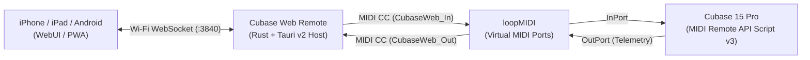

# Cubase Web Remote

Windows 上の **Steinberg Cubase 15 Pro**（Cubase 12 以降の MIDI Remote API 対応グレード）を、同一 Wi-Fi 内の **スマートフォン / iPad のブラウザ（WebUI・PWA）** から超低遅延・双方向リアルタイム同期で操作するためのリモートコントローラーです。

ライブ現場での**同期（マニピュレート）出し**と、自宅スタジオ・ブースでの**宅録セルフエンジニアリング**の両方に最適化された 2 つの専用 UI モードを搭載しています。

---

## 主な特徴

- **超軽量ネイティブ設計（Rust + Tauri v2）**
  - Electron を使わず、バックエンド（HTTP / WebSocket / MIDI 通信）をすべて Rust（`axum` + `midir`）で実装。メモリ消費が極めて少なく GC 停止も発生しないため、Cubase の ASIO オーディオ処理に一切悪影響を与えません。
- **SysEx 設定不要のリアルタイム双方向同期（Pure CC Stream v3）**
  - Cubase 初期設定の MIDI SysEx フィルターに邪魔されない独自の 3バイト CC ストリーム通信により、以下をリアルタイム表示します：
    - 現在の再生位置（小節+拍 `Bars+Beats` / 秒 / タイムコード等、日本語フォーマット名対応）
    - セカンダリタイム表示 & L / R ロケーター位置
    - Play / Stop / Record / Cycle / Metronome 状態
    - 選択中トラック名（日本語トラック名 UTF-16 対応）& フェーダー音量（dB 表記）
- **用途に合わせた 2 モード切替**
  - **LIVE 同期モード（ステージ本番用）**
    - 録音・Undo・マーカー追加などの破壊的操作ボタンを完全に非表示化。
    - **再生中誤操作ロック（Stage Safety Lock）**: 再生中に誤ってマーカーパッドに触れても再生位置が飛ばない安全機構（ワンタップで一時解除可能）。
    - **セットリスト管理**: 曲ごとにマーカー 1〜16 の名前・サブメモ・カラー（7色）を保存し、本番の曲順通りにワンタップ切替（PC 側に自動永続化）。
  - **REC 宅録モード（自宅録音・ブース用）**
    - マイク前やギターを持ったまま手元のスマホで Play / Stop / Record / Click / Precount / L・R ロケーター設定が可能。
    - **1タップ「リテイク」マクロ**: 失敗したテイクをボタン 1 つで **「停止 → Undo（直前テイク削除）→ 録音開始位置へ復帰 → 再録音スタート」** まで自動実行。
    - **選択トラック・ストリップ**: トラック前後切替、Rec 待機、モニタリング、Mute、Solo、Volume スライダー操作。
- **マーカー 1〜16 パッド（2種類のジャンプ方式に対応）**
  - **Cubase マーカー連動**: パッド `1〜9` は `To Marker 1〜9`、パッド `10〜16` は `Recall Cycle Marker 1〜7` をトリガー。
  - **位置記憶ジャンプ（Memory Cue）**: Cubase の現在カーソル位置をパッドに直接キャプチャ（記憶）し、任意の位置へダイレクトジャンプ可能。
- **PWA フルスクリーン & スリープ防止（Wake Lock）**
  - iOS Safari / Android Chrome の「ホーム画面に追加」に対応し、ブラウザのアドレスバーを消して専用アプリのように全画面表示可能。Screen Wake Lock API により演奏中・録音中の画面スリープを自動防止します。

---

## システム構成



---

## 動作環境

- **OS**: Windows 10 / Windows 11 (64-bit)
- **DAW**: Steinberg Cubase 15 Pro（MIDI Remote API を搭載した Cubase 12 以降に対応）
- **仮想 MIDI ドライバ**: [loopMIDI](https://www.tobias-erichsen.de/software/loopmidi.html)（無料）
- **クライアント端末**: PC と同一の Wi-Fi（LAN）に接続された iPhone / iPad / Android / タブレット等のモダンブラウザ

---

## インストール & 初回セットアップ手順

### Step 1. 本アプリのインストール
[Releases](../../releases) ページから最新のインストーラー（`Cubase Web Remote_x.x.x_x64-setup.exe`）をダウンロードして実行します。
> 初回起動時に「Windows Defender ファイアウォール」の確認画面が表示された場合は、スマホからの通信を受け付けるため **「プライベート ネットワーク」にチェックを入れて「アクセスを許可する」** を押してください。

### Step 2. `loopMIDI` で仮想 MIDI ポートを 2 つ作成
1. [loopMIDI](https://www.tobias-erichsen.de/software/loopmidi.html) をインストールして起動します（タスクバー常駐設定がおすすめです）。
2. 左下の **New port-name** 欄に以下の名前を入力し、**`+`** ボタンを押して **計 2 つのポート** を作成します：
   - `CubaseWeb_In`
   - `CubaseWeb_Out`

### Step 3. Cubase 用 MIDI Remote スクリプトの自動配置
1. **Cubase Web Remote** を起動します。
2. 画面の **「1. Cubaseにスクリプトを自動インストール（または最新に上書き更新）」** ボタンを押します。
   - `Documents\Steinberg\Cubase\MIDI Remote\Driver Scripts\Local\webremote\cubasectrl\webremote_cubasectrl.js` に自動配置されます。
3. `loopMIDI` を起動した状態で **Cubase 15 Pro を起動（既に起動していた場合は一度再起動）** し、プロジェクトを開きます。
   - 自動的に `CubaseWeb_In` / `CubaseWeb_Out` が検出され、ホスト画面のステータスが **「● Cubase 双方向リンク稼働中」**（緑色）に変わります。

> [!IMPORTANT]
> **推奨設定（音源の誤発音防止）**  
> Cubase メニューの **「スタジオ」→「スタジオ設定」→「MIDI ポートの設定」** を開き、`CubaseWeb_In` と `CubaseWeb_Out` の **「'All MIDI Inputs' に含める (In 'All MIDI Inputs')」のチェックを外して** おいてください。これにより、選択中のインストゥルメントトラックにリモコン用 CC 信号が混入するのを防げます。

### Step 4. スマホ / iPad から QR コードで接続
1. PC とスマホ / iPad を **同じ Wi-Fi ルーター** に接続します。
2. PC 側のホスト画面に表示されている **QRコード** をスマホ / iPad のカメラで読み取って開きます。
3. （任意）ブラウザの共有メニューから **「ホーム画面に追加」** を行うと、フルスクリーン PWA としてワンタップ起動できるようになります。

---

## トラブルシューティング

### Q. 再生・停止などの操作は効くのに、再生位置や同期ステータスが表示されない
1. ホスト画面の **「スクリプトを最新に上書き更新」** ボタンを押します。
2. `loopMIDI` で `CubaseWeb_In` と `CubaseWeb_Out` の両方があることを確認した上で、**Cubase を一度終了して再起動** してください。
3. Cubase 下ゾーンの「MIDI Remote」タブ →「MIDI Remote マネージャー」にて、`webremote / cubasectrl` の **出力（Output）ポートが `CubaseWeb_Out`** に設定されているか確認してください。
   - ※Cubase 15 で「スクリプトを再読み込み」や「スクリプトコンソール」ボタンを表示したい場合は、下ゾーン「MIDI Remote」右上の **歯車アイコン（ツールバーを設定）→「スクリプトツール」** にチェックを入れると表示されます。

### Q. スマホで QR コードを読み取ってもページが開けない
- PC とスマホが同じネットワーク帯（例：`192.168.1.x` 同士）に接続されているか確認してください（ゲスト Wi-Fi 等では端末間通信が遮断されている場合があります）。
- PC に仮想アダプタ（WSL / VPN / 仮想マシン等）がある場合、ホスト画面の **LAN IP プルダウン** を実際に使っている Wi-Fi / 有線 LAN の IP アドレスに切り替えてください。
- Windows Defender ファイアウォールで `Cubase Web Remote`（または TCP ポート `3840`）の受信がブロックされていないか確認してください。

---

## 開発・ソースからのビルド

### 必要ツール
- [Node.js](https://nodejs.org/) (v18 以降)
- [Rust](https://rustup.rs/) (stable, MSVC toolchain + Windows SDK)

### コマンド一覧

```powershell
# 依存パッケージのインストール
npm install

# 開発モードで起動 (Vite HMR + Tauri)
npm run tauri dev

# リリースビルド & Windows インストーラー生成 (src-tauri/target/release/bundle/)
npm run tauri build
```

---

## ディレクトリ構成

```text
├── cubase-script/
│   └── webremote/cubasectrl/
│       └── webremote_cubasectrl.js  # Cubase MIDI Remote API スクリプト (ES5)
├── src/                             # フロントエンド (React + TypeScript + Tailwind CSS)
│   ├── components/
│   │   ├── HostDashboard.tsx        # PC側ホスト管理画面 (QR・MIDI接続・スクリプト導入)
│   │   ├── RemoteController.tsx     # スマホ/iPad リモコン統合画面 (LIVE / REC 切替)
│   │   ├── TransportPanel.tsx       # トランスポート & 1タップリテイク操作パネル
│   │   ├── MarkerGrid.tsx           # マーカー 1〜16 パッド & メモ編集モーダル
│   │   └── TrackStrip.tsx           # 選択トラック制御ストリップ
│   ├── hooks/                       # WebSocket 自動再接続 & Screen Wake Lock
│   └── types/                       # クライアント・サーバー共通通信型定義
└── src-tauri/                       # バックエンド (Rust + Tauri v2)
    └── src/
        ├── midi_bridge.rs           # midir 双方向 MIDI エンジン & リテイクマクロ
        ├── web_server.rs            # axum HTTP / WebSocket (:3840) 配信サーバー
        └── state.rs                 # DAW リアルタイム状態 & セットリスト JSON 永続化
```
